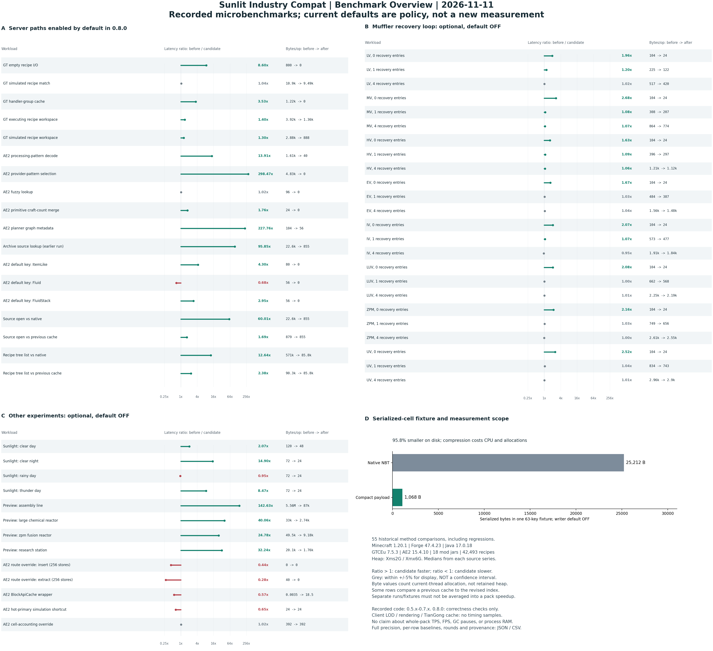
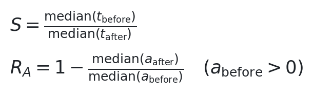
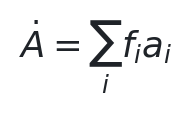
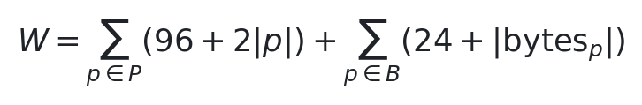
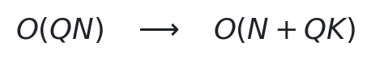
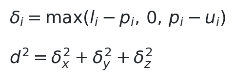
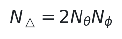
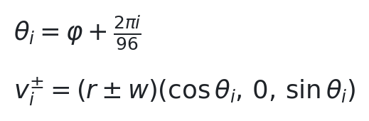
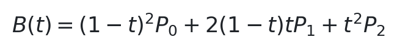

# Sunlit Industry Compat

面向 **Minecraft 1.20.1 / Forge / Java 17** 的工业整合与性能工程模块。当前版本 **0.8.0**，Mod ID 为 `sunlitindustry`。

主要处理 GTCEu 配方执行、AE2 自动合成、不可变资源索引，以及秽玄天工的配方查询与客户端特效。通过 Mixin 和生命周期感知缓存消除重复工作，保留原生物品、能量、概率与研究语义；同时提供整合包所需的能源适配和进度约束。Java 侧不新增注册内容。

## Benchmark 总览

[](docs/benchmarks/benchmark-overview-20261111.png)

总图汇总 **55 组历史方法级对照**，包含正收益、负收益与默认关闭的实验项。数据来自 0.5.x 至 0.7.x 的多轮采样；**0.8.0 只补做正确性、启动和回退验证，没有重新测量性能**。图中的默认状态按 0.8.0 标注，不代表对该版本重新跑过 benchmark。

[完整数值 JSON](docs/benchmarks/benchmark-overview-20261111.json) · [CSV](docs/benchmarks/benchmark-overview-20261111.csv) · [制图脚本](tools/server_perf/plot_benchmark_overview.py)

测试环境：Forge **47.4.23**、Java **17.0.18**、GTCEu **7.5.3**、AE2 **15.4.10**；18 个 mod jar，42,493 条配方，`-Xms2G -Xmx6G`。每个数据系列采用自身预热与保留轮次的中位数；每行记录实际轮数、调用次数、对照路径和来源摘要。部分对照在同一 JVM 内切换路径，部分采用独立 baseline JVM，不能合并成整包加速比。

| 历史测试路径 | Before / After，ns/op | Before / After，B/op |
|---|---:|---:|
| GT 空配方 I/O | 447.41 / 52.02 | 800 / 0 |
| GT handler 分组 | 1,649.95 / 467.01 | 1,224 / 0 |
| GT 执行工作区 | 2,435.21 / 1,737.35 | 3,920 / 1,360 |
| AE2 加工样板解码 | 1,526.06 / 109.69 | 1,608 / 40 |
| AE2 provider 样板选择 | 11,786.73 / 39.49 | 4,832 / 0 |
| AE2 合成图元数据 | 11,850.15 / 52.03 | 104 / 56 |
| 资源源字节读取，修订索引对照原生 | 35,563.80 / 592.60 | 22,608.96 / 854.56 |

定义耗时加速比与分配削减率：



`S > 1` 表示该路径更快，`S < 1` 表示更慢。`B/op` 来自当前线程分配计数器，表示临时分配量，不是存活堆或进程内存。图中灰色的 ±5% 仅用于视觉分类，不是统计置信区间。样板选择与图元数据属于热缓存读取，数百倍的方法级差异不能外推为服务器 TPS。

客户端尚无 FPS、帧时间或光影兼容性 benchmark；后文客户端数字均为源码层面的运算和几何预算。

## SERVER：执行路径与内存组织

| 缓存层次 | 生命周期 | 保存内容 | 失效边界 |
|---|---|---|---|
| 调用级 scratch | 单次配方/并行计算 | 临时列表、聚合表 | `finally` / 租约关闭 |
| 会话级派生缓存 | manager、level、机器或合成 job | 分组、样板、图元数据、配方子集 | 身份变化、epoch、拓扑更新、卸载 |
| 磁盘源数据快照 | 不可变 mod archive | 路径和选定原始字节 | archive 内容摘要、编码校验 |

高频对象分配的近似流量为：



其中 `f_i` 为路径每秒调用次数，`a_i` 为单次临时分配。工作区复用主要降低 `a_i`；派生缓存主要减少重复构造。缓存自身仍占驻留内存，因此同时约束容量、所有权和失效，不以单个分配指标代替总体内存结论。

### 1. GT 配方管线：结构复用与语义保留

**空输入短路。** 在 capability proxy 存在且 `IO != BOTH` 时，空内容直接返回原生 `PASS_NO_CONTENTS`。纯 AND 条件按原顺序检查并保留原生失败信息；出现 OR 条件时交给原生逻辑。模拟匹配仍纳入概率输入和不可消耗输入，但不构造实际掷骰所需的临时状态。

**拓扑验证式分组缓存。** `GTHandlerGroups` 在 owner 内保存分组结果。每次命中前仍逐项验证 handler 身份、顺序、group、distinct bypass 和 capability filter：

![Topology signature Sigma(H) = [(id(h_i), g_i, b_i, f_i)] for i = 1..size(H)](docs/formulas/handler-signature.png)

只有当前签名与缓存签名一致时复用分组。热路径仍为 `O(|H|)`，收益是省去 HashMap/List 分组构造，不是把库存匹配改为常数时间。未知 group 实现、容量超限及拓扑变化走原生路径。

**有界 RecipeRunner 工作区。** 每线程最多保留四个空闲 runner；借出后从池中移除，递归调用取得独立工作区。`finally` 清除 recipe、holder、handler、chance cache 等引用。超过源 capability 256 条、16 个工作列表或结果列表 512 条等阈值时弃池，避免偶发大配方永久抬高工作集。

**并行计算 scratch。** 聚合表保留原生 item/NBT 等价策略，每次调用重新读取库存；不同策略身份会替换对应表。嵌套租约按栈隔离，关闭时先检查顺序再弹栈。复用容器不保留上次并行数量、输入接受结果或输出数量。

概率输出继续调用原生 chance logic，保持 capability/entry 遍历顺序、持久概率债务、total-runs 和 RNG 推进。EU 层级查询只在真实概率条目需要时执行，不给可变配方维护容易过期的永久 tier 缓存。

### 2. AE2：代际缓存、原始类型计数与图记忆化

**默认 key 规范化。** 对注册 `Item` 的默认 `AEItemKey`、无 tag 的默认 `AEFluidKey` 懒初始化并复用。数量受注册表规模限制；带 NBT 的流体和 ItemStack 转换保留原生语义。该路径本来就是 `O(1)`，优化目标是减少重复分配。历史 Fluid 工厂测试也出现过延迟回退，图中保留了这一结果。

**样板解码缓存。** 正结果缓存在 `ServerLevel` 所有的有界 LRU 内，默认容量 2,048。有效性同时检查 recipe manager 身份和 recipe/tag epoch：


空结果和异常不缓存。合成样板只接纳原版精确类型的 shaped/shapeless recipe 与普通 Ingredient；自定义上下文敏感配方保留原生解码。缓存哈希查询期望 `O(1)`，但资格检查与 key 构造仍有成本。共享样板的可变 scratch-grid 操作受同步保护，临时槽位修改在 `finally` 恢复。

**provider 排序失效位。** 原生排序成功后标记排序已完成，provider 挂载/卸载继续使用原生失效逻辑。稳定 provider 集合避免每次查询重新排序、去重；root 合成节点复用不可变输入模板，非 root 的库存替代搜索仍实时执行。

**合成图元数据。** 节点计数与多路径信息按 job 的图 generation 记忆化。惰性子图展开会推进 generation；未变图的重复查询读取缓存，变化后重新遍历。缓存不承诺替换原生搜索复杂度，也不保存库存分支决策。每样板合成次数使用 primitive long map，减少装箱；原生分支回滚、缺料、容器、副产物、循环处理、暂停和取消语义保持原样。

**模糊范围复用。** 有界缓存复用边界和当前 map 的 live range view，不复制库存结果。重复 `(map, low, high)` 更新已有槽位，owner 变化清空旧 view；后续库存变更仍由 live view 反映。

### 3. 不可变 archive：内容寻址与有序资源索引

只接管识别出的物理 mod-jar 根资源。目录包、动态包、子目录包及外部来源继续由原生资源系统处理；KubeJS 事件、配方安装、标签构建和资源优先级照常运行。

archive 身份使用完整文件 SHA-256，在不可变 archive 的进程生命周期内记忆化。快照保存路径和选定原始字节，不保存 Recipe、解析后的 JSON/Tag、registry、manager 或世界引用。同一进程内替换 jar 不属于该身份模型，更新模组后需要重启。

有序路径索引的精确查询为 `O(log N)`，子树枚举为 `O(log N + K)`，其中 `K` 为返回文件数。每份缓存字节只有一个不可变 supplier，每次打开返回独立 `ByteArrayInputStream` 游标；未缓存字节的已索引文件继续用原生 I/O。

快照准入采用估算权重：



这是缓存记账公式，不是 JVM 对象布局的精确测量。资源快照缓存默认关闭，主动开启后默认 32 MiB 总预算；每 archive 最多 500,000 项、每文件 1 MiB、选定字节最多 16 MiB，磁盘快照约束为 512 MiB。达到总预算时 LRU 淘汰，淘汰后的归档在本轮资源加载中回退原生读取，避免循环工作集反复整包反序列化；每轮最多尝试装载 2048 个不同归档，下一轮服务端资源重载允许重试。配置额度变化会重建 store。磁盘校验失败从 archive 重建，其他不可恢复情况回退原生资源路径。启动参数 `-Dsunlitindustry.disableArchiveCache=true` 可直接禁用该资源 Mixin。

0.8.1 修复了超容量工作集的缓存抖动，复现数据和验证边界见 [资源缓存启动问题分析](docs/RESOURCE_CACHE_STARTUP_20261112.md)。已有配置需要显式设置 `immutableArchiveCache = false` 才会关闭；新默认值不覆盖已有的 `true`。

缓存已经发出的 supplier 可被消费者继续持有，因此预算限制的是 store 的估算驻留量，不是整个进程内存硬上限。

### 4. 秽玄天工：按 owner 隔离的配方投影

提供两项默认关闭的服务端缓存：

- `recipeHolderLists`：复用同一 recipe epoch 内的不可变 RecipeHolder 列表，去掉重复包装与列表构造。
- `materialMachineGroups`：按不可变的机器类别预筛选材料配方，供自动输入和工作查询使用。

若完整配方数为 `N`，某机器类别候选数为 `K`，同一 epoch 查询 `Q` 次，则机器类别过滤的成本从：



该式不包含仍需执行的 Ingredient/NBT 匹配、研究条件、完整性检查和工作排序。缓存不记录输入接受结果、事务、产物或加工进度，也不改变机器速率。

存储属于当前服务器 `RecipeManager`；仅当前服务器线程可使用。`apply` / `replaceRecipes` 前后、tags/config 更新和停服都会失效；外部 manager、启动线程、超限列表走原生方法。类型数、holder 数和机器分组数分别限额，不以静态世界 Map 保活旧存档。

### 5. 可选调度与序列化

| 功能 | 技术边界 | 默认 |
|---|---|---|
| 休眠多方块部件 | 仅形成且没有 active/pending tick subscription 的原生部件省去空 ticker；新订阅与解体恢复原生调度 | 关闭 |
| ME 输出合并 | 同一 level tick 的 END 阶段合并 flush；主线程执行，原生 hatch buffer 仍持有物品/流体；逐目标异常隔离 | 关闭 |
| 多方块预览快照 | 私有模板与 identity palette；每次返回独立拷贝，保留原生内部别名关系；supplier 更换/重载失效 | 关闭 |
| muffler 顺序循环 | 移除 stream/lambda 脚手架，保持原生 RNG 顺序与插入；重负载可能没有耗时收益 | 关闭 |
| 日照查询短路 | 单次查询复用坐标/biome，按维度 allow/exclude 集启用；不缓存天气或时间 | 关闭 |
| AE2 路由/邻接/单元计数实验 | 有独立开关；历史 benchmark 中有回退或收益不足，保留用于选定负载的研究 | 关闭 |
| AE2 hot-primary shortcut | 两项热键快捷路径；历史测试更慢，保留显式选择 | 关闭 |
| AE2 紧凑单元 NBT | 自包含版本化压缩、长度/数量/CRC 校验；63-key 测试夹具 25,212 B 降至 1,068 B，有压缩与解压成本 | 写入关闭 |

坏压缩单元不自动“恢复为空”。读取失败会警告、保留完整原始 NBT，并隔离该 live inventory：拒绝模拟/实际存取，阻止原生持久化覆盖数据。修复数据后需重新打开。关闭压缩写入或性能总开关仍保留已有单元的读取与保护能力。

## CLIENT：几何预算与分配消除

客户端优化精确针对 `zmod 1.40.03`，五个布尔开关均默认关闭，并受共享 master 控制。服务端启动验证不代表客户端画面或着色器已经验证。

### 1. 相机到包围盒的距离度量

辅助特效裁剪和托卡马克 LOD 使用相机到渲染包围盒的最近距离，避免用控制器点距离误判大型机器：



其中 `p` 为相机位置，`[l,u]` 为包围盒。水平方向保守扩成正方形以降低朝向变化引起的过早裁剪。距离非有限值或 bounds 无效时保留原生渲染。默认 64 blocks 外隐藏辅助等离子/气泡，外壳、端口和玻璃继续显示。

### 2. 托卡马克等离子分级网格

只切换 CORE / PLASMA / HALO 三层网格，保留原生参数方程、半径比例、材质及绘制路径。规则环面三角网格满足：



| 到渲染包围盒的距离 | 三层采样 | 三层合计三角形 | 相对原生减少 |
|---|---|---:|---:|
| `<48` blocks | 原生 `128×16 + 128×20 + 128×20` | 14,336 | 0% |
| `48–96` blocks | 每层 `64×12` | 4,608 | 67.9% |
| `≥96` blocks | 每层 `32×8` | 1,536 | 89.3% |

阈值可配置。中/远网格按需生成后复用，生成失败停用本项并返回原生网格。**这些百分比只表示等离子几何预算，不是 FPS 提升率。** 原生网格仍驻留，额外 LOD 也占数组空间，不将其描述为总体内存削减。

### 3. 圆环的公共子表达式消除

96 段圆环保留原来的 384 顶点与顶点顺序，沿环复用前一段终点：



源码中的 sin/cos 求值从逐段重复的 768 次降为 `2(96+1)=194` 次，不降低细分精度。该计数不等于实际 CPU 时间比例，JIT 仍可能对原代码进行公共表达式优化。

### 4. Bezier 与 Dyson 顶点发射

二次 Bezier 以标量展开：



输入向量不变，源码显式 `Vector3f` 构造从三个降为一个结果对象。实际分配收益取决于逃逸分析，暂不填推测的 B/frame。

Dyson primitive 直接将标量顶点写入 `BufferBuilder`，避免 quad 临时数组与 diamond 临时向量；线带侧向量使用两个线程本地 scratch 向量计算。保留原顶点、颜色、宽度与退化阈值，不减少 Dyson 的实际网格复杂度。

### 5. 渲染兼容边界

本模块不替换渲染后端、着色器、CTM 或全局 BakedModel 缓存，也未加入整台机器的视锥取消。客户端资源缓存只针对模型 JSON/metadata 的**源字节**；`clientModelSourceCache` 默认关闭，检测到 ModernFix 或 Fusion 时不安装该客户端资源挂钩。

服务端缓存与客户端视觉是不同侧的 Mixin：专用服务端优化不会自动作用于单人游戏的 integrated server。双端安装时，服务端执行配方/网络模块，客户端执行视觉模块和所需兼容读取。

## 开关与部署

| 配置文件，位于 `config/` | 主要内容 | 默认状态 |
|---|---|---|
| `sunlitindustry-server-performance.toml` | 共享 master、GT 基础路径、AE2 默认 key/模糊查询 | 已有基础项开启，紧凑写入关闭 |
| `sunlitindustry-gt-advanced.toml` | runner/scratch、tick/ME/预览实验 | runner/scratch 开启，其余关闭 |
| `sunlitindustry-ae2-crafting.toml` | 样板解码、provider 排序 | 开启 |
| `sunlitindustry-ae2-planner.toml` | primitive 计数、图元数据、hot-primary | 前两项开启，hot-primary 关闭 |
| `sunlitindustry-resources.toml` | 不可变 archive、客户端模型源字节、内存预算 | 服务端开启，客户端源字节关闭 |
| `sunlitindustry-tiangong-server.toml` | holder 列表、材料机器分组 | 全部关闭 |
| `sunlitindustry-tiangong-client.toml` | 几何分配、距离特效、等离子 LOD | 全部关闭 |
| `sunlitindustry-ae2-network-experiments.toml` | 路由、邻接、单元计数实验 | 全部关闭 |
| `sunlitindustry-world-performance.toml` | 日照优化及维度选择 | 关闭 |
| `sunlitindustry-gt-muffler.toml` | muffler 顺序循环 | 关闭 |
| `sunlitindustry-legacy-performance.toml` | WorldEdit 状态索引、KubeJS 原始配方快捷读取 | WorldEdit 关闭，KubeJS 开启 |

关闭性能项后继续执行原生方法。兼容性修复、整合包平衡规则和已有紧凑数据的读取保护不属于该回退开关。加载阶段还会检查物理侧、目标版本和冲突模块，避免在不支持的 API 上应用补丁。

共享运行时总开关：`sunlitindustry-server-performance.toml` 中的 `enabled`。需要在加载阶段排除可选性能 Mixin 时，使用以下 JVM 参数并重启：

```text
-Dsunlitindustry.disableServerOptimizations=true
```

日照维度选择示例：

```toml
gtSunlightQuery = false
sunlightDimensions = ["minecraft:overworld"]
sunlightExcludedDimensions = []
```

空 allowlist 不匹配任何维度；`["*"]` 匹配全部，排除名单优先。配置加载/更新后构建不可变集合，热路径不重复解析标识符。现有配置中的显式值优先于新版默认值，升级不会替用户关闭以前已启用的实验。

配置模板见 [pack/config](pack/config)，详细开关见 [Optional Performance Features](docs/OPTIONAL_PERFORMANCE_FEATURES.md)。

## 整合与正确性修复

性能模块之外，仓库还维护以下整合功能：

- **Mekanism / GT EU 物品适配**：直接使用原生严格能量容器，不新增能量副本。转换采用 GT 的 EU/FE 比例与 MEK 的 FE/J 配置；整合包默认 `1 EU = 4 FE = 10 J`。按整 EU 向下取整，保留模拟、传输上限、堆叠数和充电器电压级别。只有生存电池片与能量立方可对外供 EU，工具/盔甲不作为 GT 电池。
- **虚空 MekaSuit 继承**：只对显式标记的四件装配线配方，在扣料前将原 MekaSuit 序列化状态复制到私有输出配方，保留模块、能量、附魔和名称。UHV 装配线、对应 KAMI 样品研究与数据球由 `pack/` 和整合包 KubeJS 配方定义，不是性能缓存生成的进度。
- **研究载体约束**：阻止将需要 Data Bank 的研究模块向低级数据载体复制，保留同级复制与升级。万象阵核心消耗只发生在形成成功后。
- **MEK 核工业限制**：可配置的实际聚变/裂变燃耗约束覆盖 setter 以外的调用与 NBT 恢复；配置在 `sunlitindustry-common.toml`。燃耗限制不等于测得的最终发电量。
- **GCYR 火箭燃料**：按当前引擎与 live recipe manager 验证；配方重载后重新解析。以预付小数 credit 处理每 tick 小于 1 mB 的耗量，避免整数截断产生免费燃料；credit 始终在 `[0,1)` 且绑定对应流体。
- **Forge tag 并发**：保留原方法体，对 tag handle 创建/绑定添加同步，避免并行配方读取持有丢失的 handle；不在每次 Ingredient membership 上加锁。
- **启动与提示兼容**：FTBBackups2 的空 map-colour 预览回退；KubeJS 已有缓存的提前读取；ALI 补丁先验证字节码形状，未知形状保留原字节码并警告。

目标 API：Forge **47.4.23**、GTCEu **7.5.3**、AE2 **15.4.10**、Mekanism **10.4.16.80**、秽玄天工 **1.40.03**、GCYR **0.2.9**。按具体模块执行版本门控，目标 mod 缺失时跳过其可选 Mixin；升级目标依赖后应重新检查对应挂钩。

## 构建与验证

使用 JDK 17 和 Gradle 8.x；本地验证使用 Gradle 8.14.5。`build.gradle` 包含秽玄天工的本地 compile-only jar 路径和本地 Maven 仓库引用，新 checkout 需要按自己的环境调整依赖位置；这些依赖不会被打进最终 jar。

```powershell
gradle --offline test build
```

产物：`build/libs/sunlit-industry-compat-1.20.1-0.8.0.jar`。离线构建需要先准备完整依赖缓存。

0.8.0 验证结果：**65 个单元测试，零失败/错误**；18-mod 隔离专用服务器成功启动，42,493 条配方保持稳定；7 个新/恢复目标类、18 项维度策略、8 组坏单元隔离、4 棵资源子树和 305 次源字节对照通过。历史测试另覆盖概率/RNG 债务、handler 拓扑、真实样板规划、部件 tick 生命周期以及 KubeJS 配方替换/删除/恢复。

隔离服工具位于 `tools/void_suit/`、`tools/server_perf/`，通过 loopback Rosetta 执行服务器线程探针。测试工具依赖本地整合包路径；它们不构成自动部署到生产服的命令。配方重载使用 `minecraft:reload`。

仅重新生成总图，无需启动游戏或重跑 benchmark：

```powershell
python -I tools/server_perf/plot_benchmark_overview.py
```

制图依赖 Matplotlib。脚本从已提交的 JSON 汇总数值并校验共同环境字段，输出 PNG、JSON 和 CSV；不生成新的性能样本。

公式图片由 `python -I tools/docs/render_readme_formulas.py` 重新生成，使用仓库内静态 PNG，避免 Markdown 渲染器的 LaTeX 宏限制。

[代码质量复核与修复记录](docs/CODE_QUALITY_REVIEW_20261111.md) · [天工服务端缓存契约](docs/TIANGONG_SERVER_RECIPE_CACHES.md)
