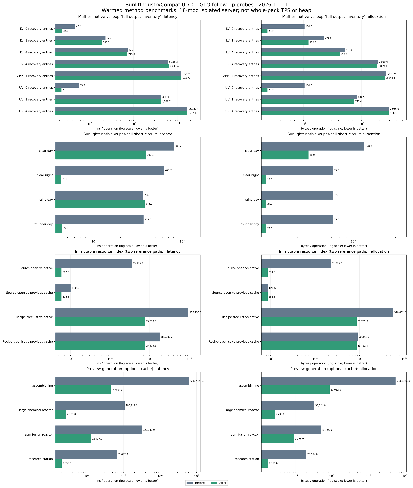

# GTO Follow-up Optimization - 2026-11-11

## Scope

SunlitIndustryCompat 0.7.0 adds stock-GTCEu-compatible optimizations after reviewing
GTOCore, recovered GTOLib, and the WarpLoad cache failure analysis. This is an
adaptation of selected techniques, not a replacement GTCEu or AE2 distribution.
The complete feature matrix is [GTO_MIGRATION_MATRIX.md](GTO_MIGRATION_MATRIX.md).
Previous GT runner, grouping, AE2 crafting and fuzzy-query measurements remain in
[SERVER_PERFORMANCE_BENCHMARK_20261111.md](SERVER_PERFORMANCE_BENCHMARK_20261111.md).

[JSON](benchmarks/gto-followup-20261111.json) and
[CSV](benchmarks/gto-followup-20261111.csv) contain all 36 comparisons, including
regressions. Regenerate with `python -I tools/server_perf/plot_gto_followup.py`.

## Added or Improved

- Muffler recovery: replace IntStream/lambda scaffolding with an ordered loop;
  keep native chance calculation, RNG order, ItemStack copies and insertion.
- GT sunlight: reuse the above-position and biome query within one call; short
  circuit when the result is already known. No weather/time/biome result cache.
- Immutable archive index: retain one supplier per admitted source, opening a
  fresh stream for each read; enumerate indexed trees without copying paths or
  repeatedly resolving the same snapshot. Admission accounts for supplier cost.
- Optional preview cache: retain private shape templates using an identity
  palette, preserve internal BlockInfo sharing, and copy NBT/ItemStack/capability
  state between requests. Unsupported custom BlockInfo/callbacks fall back to
  native generation; failed captures are skipped until invalidation. Existing
  bounds and reload/setter invalidation remain active.
- Real chunk-tick lifecycle probe for the existing opt-in dormant-part ticker.

Muffler and sunlight optimizations default on. Preview caching and dormant-part
tick suppression remain off by default. Their config files are
`sunlitindustry-gt-advanced.toml`, `sunlitindustry-gt-muffler.toml`, and
`sunlitindustry-world-performance.toml`. Module enablement also obeys the shared
server-performance switch and the dedicated-server, version and conflict gates.

## Environment and Method

- Isolated `G:/emoney-void-suit-test`; loopback Rosetta, Minecraft port 25584.
- Minecraft 1.20.1, Forge 47.4.23, Java 17.0.18, GTCEu 7.5.3, AE2 15.4.10.
- 18 mod jars selected with mandatory-dependency parsing; `-Xms2G -Xmx6G`.
- Server-thread A/B within the same transformed JVM: feature-disabled native
  implementation versus optimized implementation. The resource probe also
  reconstructs the previous supplier path to measure this iteration alone.
- Discard negative warmup rounds and round zero. Report median of four retained
  rounds, or three for previews. Per-round checksums agree between paired paths.
- ThreadMXBean measures current-thread allocated bytes. These are warmed method
  probes, not JMH, total RSS, retained heap, GC latency, client FPS or base TPS.
- Muffler/sunlight/resource captures use `gto-followup-final`; final palette
  previews and final-jar correctness use `gto-followup-release`. Source manifest
  hashes are included in the JSON. Those three production modules did not change
  between the two runs.

Final tested jar: `build/libs/sunlit-industry-compat-1.20.1-0.7.0.jar`.
SHA-256: `47483c11ec5d4c0622d09e2a5cfb85715704c1efaf5f4858facf10e489a437fb`.

## Measurements

| Workload | Before ns/op | After ns/op | Before B/op | After B/op |
|---|---:|---:|---:|---:|
| LV muffler, zero entries | 45.4 | 23.1 | 104.0 | 24.0 |
| LV muffler, one entry | 226.6 | 188.2 | 224.6 | 122.4 |
| UV muffler, four entries | 16,930.4 | 16,691.3 | 2,956.0 | 2,903.9 |
| Clear day sunlight | 806.2 | 390.1 | 120.0 | 48.0 |
| Clear night sunlight | 627.7 | 42.1 | 72.0 | 24.0 |
| Rainy day sunlight | 357.8 | 376.7 | 72.0 | 24.0 |
| Resource source, previous cache | 1,000.0 | 592.6 | 878.6 | 854.6 |
| Recipe tree, previous cache | 180,280.2 | 75,673.5 | 90,344.0 | 85,752.0 |
| Assembly Line preview, native | 6,367,590 | 44,645 | 5,563,552 | 87,032 |
| ZPM Fusion preview, native | 320,147 | 12,917 | 49,456 | 9,176 |
| Research Station preview, native | 65,697 | 2,038 | 20,064 | 1,760 |

The muffler gain is primarily lower allocation. Heavy recovery remains dominated
by native chance and inventory work: the IV/four-entry run was about 5% slower;
ZPM/four-entry latency was unchanged. Rainy-day sunlight was about 5% slower
despite saving 48 B/call. The report retains these cases instead of claiming a
uniform speedup. No confidence interval or whole-pack gain is inferred.

Resource source lookup is 40.7% faster than the previous cache path; tree
enumeration is 58.0% faster in this fixture. Native filesystem comparisons are
also included in the chart, but those are not this iteration's incremental gain.

The first preview draft allocated more than native for ZPM fusion. Retaining
identity sharing fixed that regression: the final measurement is 9,176 B/op,
versus native 49,456 B/op. This cache still retains bounded template data; lower
per-call allocation does not establish lower total retained heap.

## Validation

`gradle --offline test build` passed; 52 unit tests have zero failures/errors.
The final 0.7.0 jar booted and registered 42,493 recipes. Runtime evidence is in
`G:/emoney-void-suit-test/evidence/gto-followup-*`.

- Mufflers: 3,072 native-versus-loop comparisons across all eight registered
  LV/MV/HV/EV/IV/LuV/ZPM/UV definitions, preserving inventory, templates and RNG.
- Sunlight: 2,304 comparisons across six loaded dimensions; native and optimized
  booleans agree. JAVD is absent, so its inverse-day branch was source-reviewed
  but not runtime-tested.
- Resource index: four trees, 305 source comparisons, 144 cached suppliers,
  8,428 fallback entries and 10 independent stream-cursor checks passed.
- Preview: array, BlockInfo, NBT, ItemStack, charged Mekanism capability isolation,
  internal identity sharing, callback fallback and supplier replacement passed.
  Four real registered machine definitions were benchmarked.
- Dormant part: 46 actual LevelTicks, 12 exact-once subscriber invocations;
  sleep, wake, unsubscribe, unform, reform and removal all passed. No manually
  driven machine tick substitutes for the chunk scheduler in this probe.
- Existing runner and handler grouping checks passed 4,096 RNG/debt comparisons
  and 14,400 comparisons over 300 topologies. AE2 pattern/planner probes passed
  on the integrated 0.7.0 source before the final preview-only refinement.
- Final-jar KubeJS reload: `base -> alternate -> removed -> base` produced counts
  `42493 -> 42493 -> 42492 -> 42493`; positive and negative ingredient matches
  changed correctly. No repeated recipe accumulation occurred.

KubeJS reports zero script errors/warnings. The surrounding Forge log still has
known Rhino client-class reflection errors (ClientLevel, GuiGraphics,
WorldSceneRenderer, Font), GT duplicate-smelting lookup warnings, and missing
optional Blood Magic overlay items in this deliberately reduced mod set.
The client-class errors also occur in the optimization-disabled baseline; do not
interpret a successful recipe check as a clean server log.

## Exclusions and Remaining Limits

- Stock 7.5.3 lacks GTO's recipe `tier` field and altered RecipeRunner contracts.
  The existing compatible runner workspace reuse remains; no full RecipeLogic
  state-machine overwrite is claimed.
- No asynchronous mutation of inventories, AE grids, chance state or worlds.
- No blanket multiblock tick suppression, chunk-unload overwrite or random-tick
  throttling. Native world generation already has biome/dimension ore caches.
- GTO's Class.getName redirect in chunk saving only changes failure logging,
  not NBT serialization; it offers no normal-path optimization to copy here.
- No duplicate capability cache around getters that already return fields.
- No parsed JSON/Tag/Recipe disk cache or dynamic-pack replay. Archive caching
  remains source-bound and bounded; KubeJS/dynamic resource packs stay native.
- Preview suppliers that mutate shapes without a setter/reload can produce a
  stale snapshot when the experimental option is enabled; keep it off unless
  that supplier contract has been checked for the deployed addon set.
- No client baked-model/CTM cache or FPS claim. Client resource-byte hooks remain
  opt-in and gated out with ModernFix/Fusion. No full-pack compatibility test or
  large industrial-base benchmark is claimed by this reduced server run.

Production client and server were not changed by these tests.
