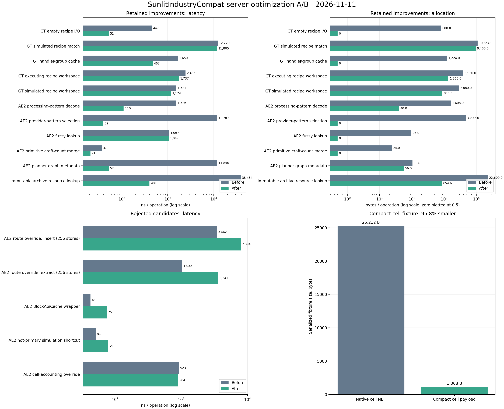

# Server Performance A/B - 2026-11-11

## Result

The final build keeps measured wins and removes the candidate mixins that were
slower or did not reduce allocations. The chart includes both retained changes
and rejected experiments:

Machine-readable results: [JSON](benchmarks/expanded-server-benchmark-20261111.json),
[CSV](benchmarks/expanded-server-benchmark-20261111.csv). The chart can be
regenerated with
`python -I tools/server_perf/plot_expanded_benchmarks.py`.

## Workload

- Dedicated Forge 1.20.1 server, Forge 47.4.23, Java 17.0.18.
- GTCEu 7.5.3, AE2 15.4.10, 18 staged mod jars, `-Xms2G -Xmx6G`.
- Same recipe set in both runs: 42,493 recipes, one KubeJS benchmark recipe,
  14 synthetic GT input handlers.
- Baseline launches the same isolated mod set with server optimization mixins
  disabled. Final uses the optimized runtime settings.
- Five warmup rounds; report uses the median of four recorded rounds.
- Results are isolated microbenchmarks and should not be read as whole-pack TPS,
  real-base tick time, or post-GC heap measurements.

## Retained Changes

| Workload | Before | Final | Change |
|---|---:|---:|---:|
| GT empty recipe I/O | 447 ns, 800 B | 52 ns, 0 B | 88% faster |
| GT handler-group lookup | 1,650 ns, 1,224 B | 467 ns, 0 B | 72% faster |
| GT executing recipe workspace | 2,435 ns, 3,920 B | 1,737 ns, 1,360 B | 29% faster, 65% less allocation |
| AE2 processing-pattern decode | 1,526 ns, 1,608 B | 110 ns, 40 B | 93% faster, 98% less allocation |
| AE2 provider-pattern selection | 11,787 ns, 4,832 B | 39 ns, 0 B | 99.7% faster |
| AE2 planner graph metadata | 11,850 ns, 104 B | 52 ns, 56 B | 99.6% faster |
| Archive resource lookup | 38,434 ns, 22,609 B | 401 ns, 855 B | 99% faster, 96% less allocation |

GT simulated recipe matching improved 3.5% in this run, with 12.7% fewer
allocated bytes. AE2 fuzzy-bound reuse removed 96 B per query; its latency change
was within noise. Primitive planner craft counts removed a 24 B allocation and
were faster in the final repeated-merge probe.

## Rejected Experiments

- AE2 priority-routing snapshot: insert went from 3,462 ns to 7,895 ns; extract
  from 1,032 ns to 3,641 ns. The mixin and helper classes were removed.
- AE2 `BlockApiCache` wrapper: 43 ns to 75 ns and about 18 B per lookup. Removed.
- Planner hot-primary shortcut: 51 ns to 79 ns, with no allocation reduction.
  Removed.
- Primitive cell accounting: allocation stayed at 392 B; the roughly 2% timing
  difference was within run-to-run noise. Removed.

Compact cell NBT is retained as an opt-in format, not a speed optimization. Its
63-key synthetic payload was 25,212 B natively and 1,068 B compacted (95.8%
smaller). One compact-plus-expand probe took roughly 0.5 ms and allocated about
327 KB, so compact writing remains disabled by default.

## Validation

`gradle test build` passed on the final source tree. The final jar booted in the
minimal test server and registered all 42,493 recipes. Runtime checks passed for
4,096 GT runner probability/debt/RNG comparisons, 300 GT handler topologies
(14,400 comparisons), AE2 recipe-plan scenarios, reload invalidation, native AE2
routing semantics, fuzzy-view mutation, compact-cell round trips, and opt-in GT
experiments.

KubeJS reload changed the probe recipe through `base -> alternate -> removed ->
base`; counts were 42,493 -> 42,493 -> 42,492 -> 42,493. KubeJS reported zero
script errors and warnings. Each load still logs three Forge
`RuntimeDistCleaner` errors while Rhino inspects client-only LDLib widgets
(`GuiGraphics`, `WorldSceneRenderer`, and `Font`); both scripts load and the
recipe checks pass.

Only `G:\\emoney-void-suit-test` was used. The production server was not changed.
